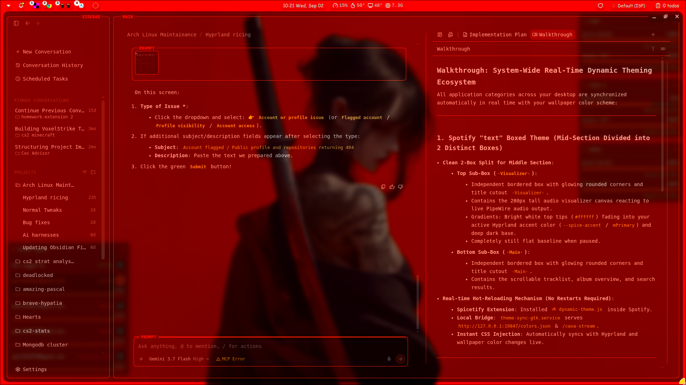
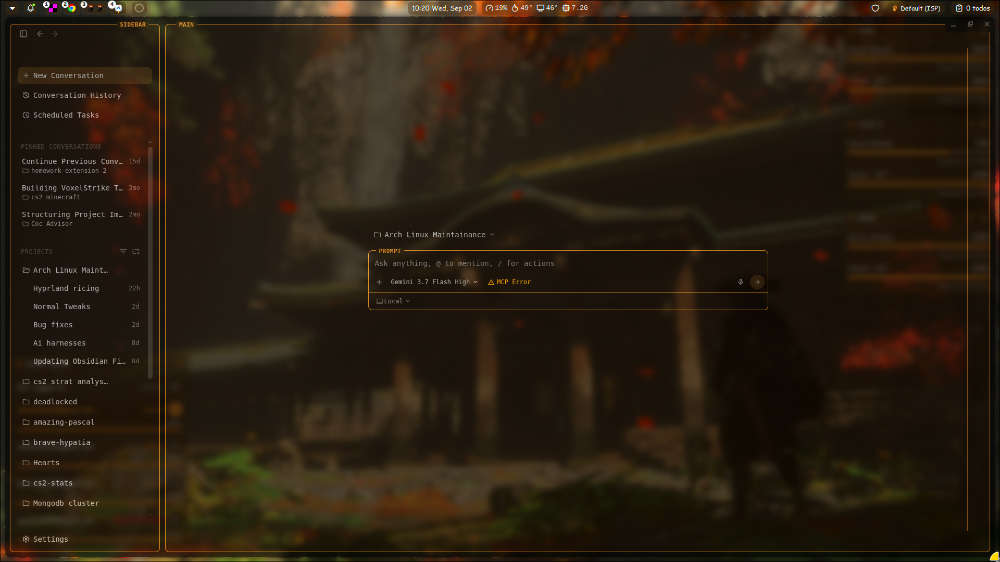
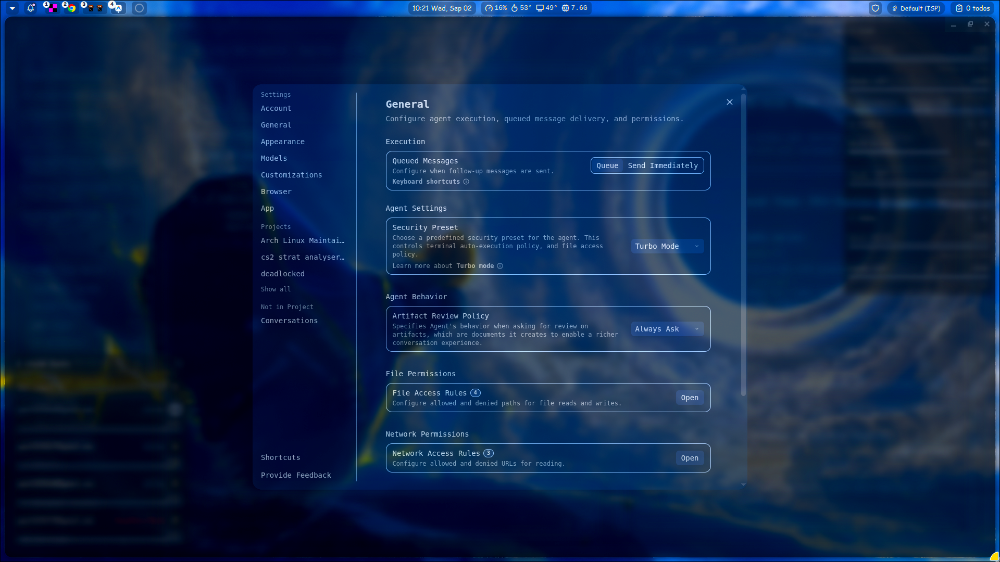

# 🌌 Google Antigravity 2.0 Custom Theme & Dynamic Styling Engine

[](https://opensource.org/licenses/MIT)
[](https://antigravity.google)
[](https://python.org)
[](https://archlinux.org)
[]()

> **The ultimate real-time dynamic theming engine and modular boxed terminal aesthetic for Google Antigravity (Antigravity 2.0 / Antigravity IDE).**  
> Seamlessly synchronize your Antigravity IDE colors with your desktop wallpaper (Material 3, Pywal, Matugen, Noctalia) with zero restarts via live Chrome DevTools Protocol (CDP) CSS injection.

---

## 📸 Visual Showcase

### 🔴 Crimson Theme & Split Walkthrough Workspace


### 🟠 Amber Autumn Theme & Modular Boxed Workspace


### 🔵 Blue Theme & Frosted Glass Settings Modal


---

## 📸 Architecture & Layout

```
┌─────────────────────────────────────────────────────────────────────────────────┐
│                                                                        SIDEBAR  │
│  [|]  <-  ->                                                                    │
│ ┌─────────────────────────────────────────────────────────────────────────────┐ │
│ │  + New Conversation                                                         │ │
│ │  🕒 Conversation History                                                    │ │
│ │  📁 PROJECTS                                                                │ │
│ │     • Arch Linux Maintainance                                               │ │
│ │                                                                             │ │
│ │  ⚙️ Settings (16px Radius Modal + Floating Inset Divider)                    │ │
│ └─────────────────────────────────────────────────────────────────────────────┘ │
├─────────────────────────────────────────────────────────────────────────────────┤
│ MAIN                                                                            │
│ ┌──────────────────────────────────────┬─┬────────────────────────────────────┐ │
│ │ PROMPT                               │ │ Walkthrough: Dynamic Ecosystem     │ │
│ │ ┌──────────────────────────────────┐ │ │                                    │ │
│ │ │ Ask anything, @ to mention...    │ │ │ 1. Clean Modular Aesthetic         │ │
│ │ ├──────────────────────────────────┤ │ │ 2. Real-Time Color Synchronizer    │ │
│ │ │ 🔲 Local ▾         [Send ➔]      │ │ │ 3. Flawless Notched Outline Mask   │ │
│ │ └──────────────────────────────────┘ │ │                                    │ │
│ └──────────────────────────────────────┴─┴────────────────────────────────────┘ │
└─────────────────────────────────────────────────────────────────────────────────┘
```

---

## ✨ Key Features

- **🪟 Frosted Glass Translucency (1:1 with Spotify):** Unified translucent glass surfaces (`rgba(surface, 0.55)` + `backdrop-filter: blur(12px)`) with Hyprland wallpaper pass-through.
- **🏷️ Seamless Notched Cutout Legends:** Custom simulated notched badges (`SIDEBAR`, `MAIN`, `PROMPT`) with surface masking that prevents borders from cutting through label text.
- **⚡ Real-Time Live Hot-Reloading:** Injects CSS dynamically into running Electron instances via Chrome DevTools Protocol (CDP) WebSocket without closing or reloading your active session.
- **🎨 Material 3 / Dynamic Wallpaper Sync:** Auto-detects palette changes from Noctalia, Matugen, Pywal, or custom `colors.json` files and syncs colors across all UI components instantly.
- **🧼 Zero Dark Patches:** Nested containers, prompt boxes, and message bubbles render with 100% unified transparency.
- **⚙️ Redesigned Settings Modal:** Features a sleek `16px` border-radius container, frosted glass backdrop blur, and an inset floating vertical divider.
- **📏 Floating Split Pane Divider:** Clean `1px` floating separator between chat and artifact/walkthrough views with interactive hover accent glow.
- **🗂️ Built-in Skills & Commands Hub:** Integrated slide-out drawer accessible right from the sidebar (`Skills Hub [/cmd]`) with searchable categorised skills, collapsible accordions, and 1-click clipboard copy & prompt insertion.
- **🛠️ Automated Electron Patcher (`patch_app_asar.py`):** Replaces the startup white screen flash with a dark theme-matched loading overlay, hides the top window bar cleanly in tiling window managers (Hyprland/Sway), and fixes sidebar scrolling.
- **🚀 Automated 1-Click Installer:** Includes launcher wrapper, desktop menu integration, systemd user daemon, and Hyprland compositor rule setup.

---

## ⚡ Quick Installation

### Option 1: One-Line Automatic Install (Recommended)

```bash
git clone https://github.com/ypatil2006-coder/antigravity-custom-theme.git ~/.config/antigravity-custom-theme
cd ~/.config/antigravity-custom-theme
chmod +x install.sh sync_antigravity_theme.py
./install.sh
```

### Option 2: Manual Installation

1. **Clone the repository:**
   ```bash
   git clone https://github.com/ypatil2006-coder/antigravity-custom-theme.git
   cd antigravity-custom-theme
   ```

2. **Create the launcher wrapper (`~/.local/bin/antigravity`):**
   ```bash
   cat << 'EOF' > ~/.local/bin/antigravity
   #!/bin/bash
   exec /usr/bin/antigravity --remote-debugging-port=41013 "$@"
   EOF
   chmod +x ~/.local/bin/antigravity
   ```

3. **Update your desktop launcher entry (`~/.local/share/applications/antigravity.desktop`):**
   ```bash
   sed 's|Exec=/usr/bin/antigravity|Exec=/home/'"$USER"'/.local/bin/antigravity|g' /usr/share/applications/antigravity.desktop > ~/.local/share/applications/antigravity.desktop
   update-desktop-database ~/.local/share/applications
   ```

4. **Configure Hyprland Translucency (Optional):**
   Add this to your `~/.config/hypr/windowrules.conf`:
   ```ini
   windowrule = opacity 0.75 0.70, class:^(antigravity|Antigravity)$
   ```

5. **Run the theme synchronizer:**
   ```bash
   python3 sync_antigravity_theme.py --watch
   ```

---

## ⚙️ Configuration & Theming

### Custom Colors File
By default, the script checks for Material 3 palettes in:
1. `~/.config/noctalia/colors.json`
2. `~/.config/hypr/colors.json`
3. Fallback default colors

Sample `colors.json` schema:
```json
{
  "mPrimary": "#f5f0c9",
  "mSurface": "#292714",
  "mSurfaceVariant": "#452521",
  "mOnSurface": "#f3f3f2",
  "mOnSurfaceVariant": "#b6b0af",
  "mOutline": "#72705d",
  "mError": "#fd4663"
}
```

---

## 🛠️ CLI Usage & Flags

### 1. Dynamic Theme Synchronizer
```bash
# Sync active colors and live-inject into running Antigravity instances once
python3 sync_antigravity_theme.py

# Run in background daemon mode (watches for palette changes)
python3 sync_antigravity_theme.py --watch
```

### 2. Standalone App Patcher (Skills Hub & UI Polish)
```bash
# Patches app.asar to install the Skills Hub drawer, hide the top bar, and theme the startup screen
python3 patch_app_asar.py
```
*Note: Requires `npx` / `@electron/asar` installed to unpack and repack Electron archives.*

---

## 🤝 Contributing

Contributions, issues, and feature requests are welcome! Feel free to check the [issues page](https://github.com/ypatil2006-coder/antigravity-custom-theme/issues).

---

## 📜 License

Distributed under the [MIT License](LICENSE).
